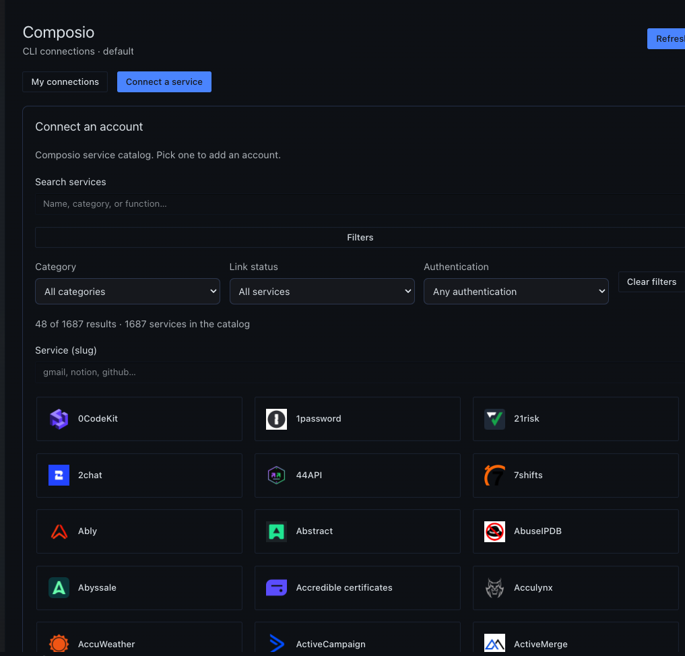
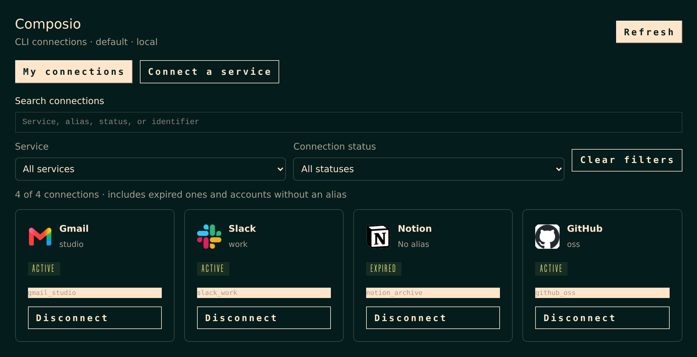
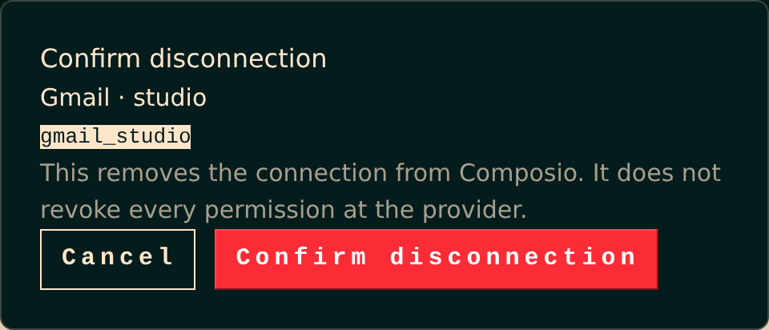
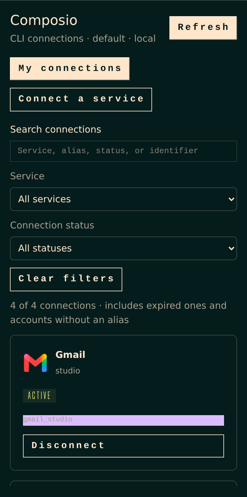

# Composio Connections

Connect and disconnect Composio accounts from Hermes. The same page runs in Hermes Desktop and in the web dashboard.



It lists every row the Composio CLI returns: active, expired, duplicated, and accounts with no alias. OAuth opens in your browser. Disconnect names the exact account and checks that it is gone. The assistant keeps using the Composio CLI. This plugin does not add agent tools.

The account pictures below use example data. The picture above is the Hermes Desktop plugin.



## Connect a service

The catalog is the official Composio toolkit list, not only the services you already have. Logos are packed into the plugin, so opening the page does not call an image host. Search and filters apply before the list pages itself.


## Disconnect one account

Confirmation shows the alias and the exact identifier. Removing the connection from Composio does not revoke every permission at Google, Slack, GitHub, or any other provider.



## Narrow layout

Filters stack. The first account stays on screen. Nothing has to scroll sideways.



## Install

Hermes 0.22.5 or newer. The packaged release is [v0.1.7](https://github.com/luisced/hermes-composio-connections/releases/tag/v0.1.7).

From Git, which tracks this repository:

```sh
hermes plugins install luisced/hermes-composio-connections
hermes plugins enable composio-connections
```

Or install the release package. It unpacks to `composio-connections/` with `plugin.yaml` at the top of that folder:

```sh
unzip composio-connections-0.1.7.zip -d ~/.hermes/plugins
hermes plugins enable composio-connections
```

Check `SHA256SUMS` before unpacking. The catalog needs `COMPOSIO_USER_API_KEY` in the Hermes secret store for that profile. Inventory, connect, and disconnect use a logged-in `composio` CLI on the gateway. The key never goes to the browser.

On the machine that runs Hermes Desktop, install the desktop file as well:

```sh
python3 install-desktop.py
```

That copies only `desktop/plugin.js` into `~/.hermes/desktop-plugins/composio-connections/`. It does not install the backend and it refuses to overwrite a different file. Then reload desktop plugins.

## What it follows

The page uses the active Hermes language: English, Spanish, simplified and traditional Chinese, Japanese, Arabic, Russian, French, German, Turkish, Ukrainian, Afrikaans, Korean, Italian, Irish, Portuguese, and Hungarian. Anything else falls back to English. Service names, categories, and raw Composio statuses stay as Composio sends them.

An expired account still counts as a service you have added. It does not count as a live authorization.

## Limits

- The scope is the Composio context of the CLI. Other organizations, and Hermes connectors that are not Composio, do not appear.
- `ACTIVE` does not prove that every granted permission has been used.
- The confirmation step needs a Unix PTY. If the CLI prompt changes, the mutation fails closed.
- This repository is the installable plugin. It is not yet a listing in the official Hermes catalog.

## Development

```sh
uv venv .venv
uv pip install --python .venv/bin/python pytest pytest-asyncio httpx fastapi pyyaml
.venv/bin/python -m pytest -q
node scripts/build-dashboard.mjs
node dashboard/web-test.mjs
```

UI tests live in `tests/ui`. They drive the shipped page with fixture accounts. They do not touch a real Composio account.

## License

[MIT](LICENSE)
